# EDA Report: International Debt Statistics

**Source:** World Bank International Debt Statistics (IDS), last updated 12/03/2025
**Scope:** 120 low- and middle-income countries, 2000–2024 actual data (2025–2032 scheduled payments)
**Notebook:** [`notebooks/01_data_cleaning_and_eda.ipynb`](../notebooks/01_data_cleaning_and_eda.ipynb). Every number below comes from it.

---

## 1. The dataset

| Item | Value |
|---|---|
| Raw file | `IDS_ALLCountries_Data.csv`, 62,983 rows × 39 columns, wide format (one column per year) |
| Years | 2000–2032 (33 columns). 2025+ hold only *scheduled* principal and interest on existing debt |
| Entities | 134 = **120 countries** + 14 regional / income-group aggregates |
| Indicators | 576 = 541 US$, 27 percentages, 6 in years, 2 other |
| Encoding | latin-1. The file contains non-breaking-space bytes, so it is not valid UTF-8 |

## 2. Data quality and cleaning

| Issue found | Action taken |
|---|---|
| 5 footer / blank rows ("Last Updated…", "Data from database…") | Dropped |
| `Country Code` padded with spaces (`"AFG       "`) | Stripped, along with all text columns |
| `Counterpart-Area` always "World" | Column dropped (no information) |
| Duplicates | Checked on full rows and on country + series keys. The only full-row duplicates were the blank footer lines, and no real data rows repeat |
| **35.3% of cells missing**: 19–22% per actual year, ~80% in projection years | Dropped, not imputed, because a missing debt figure means "not reported" rather than zero. 3,340 series have no data at all |
| 14 aggregates mixed in with countries | Flagged `is_aggregate = 1` and excluded from country totals so nothing is double-counted |
| Ethiopia has no income group in the metadata | Labelled "Not classified" |
| Wide format (33 year columns) | Melted to long format, giving **1,345,046** clean rows (country, indicator, year, value) |
| Mixed units | Unit and category parsed from each series name (e.g. `(DOD, current US$)`) |

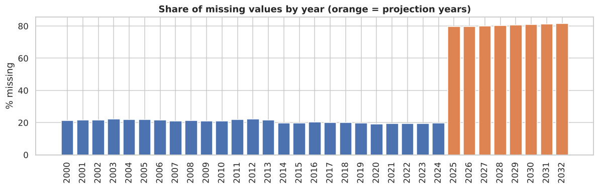

**Defining "debt."** Indicators overlap. *External debt stocks, total* already includes *long-term*, *short-term*, *PPG* and so on, so summing everything would multiply-count the same dollars. This project uses:

- **Country debt** = *External debt stocks, total (DOD, current US$)* (`DT.DOD.DECT.CD`)
- **Composition** = 4 non-overlapping components (PPG, PNG, short-term, IMF credit). They add up to the total within 0.05%, which the pipeline checks automatically.

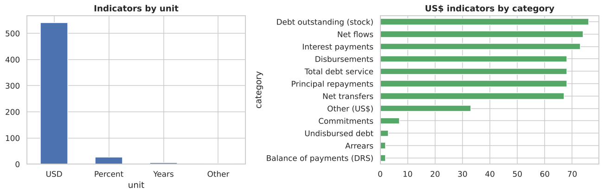

## 3. Findings

### 3.1 Debt has nearly quintupled since 2000
Total external debt rose from **$1.83T (2000) to $8.94T (2024)**. That is 4.9×, or 6.8% a year, and 2024 is the highest point in the series.

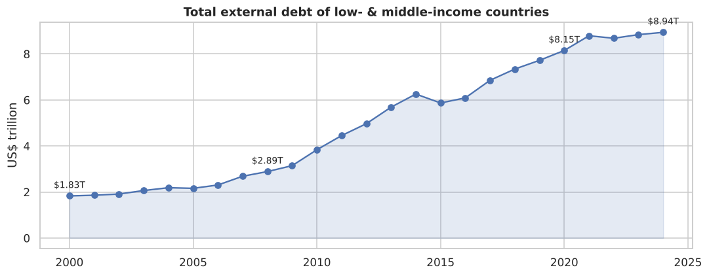

### 3.2 Highest and lowest debt
| Highest (2024) | Debt | Lowest (2024) | Debt |
|---|---|---|---|
| China | $2.42T | Tonga | $173M |
| India | $716B | Timor-Leste | $297M |
| Brazil | $605B | Sao Tome and Principe | $326M |
| Mexico | $591B | Comoros | $386M |
| Turkiye | $515B | Samoa | $395M |

China's debt peaked at $2.72T in 2021 and has fallen since.

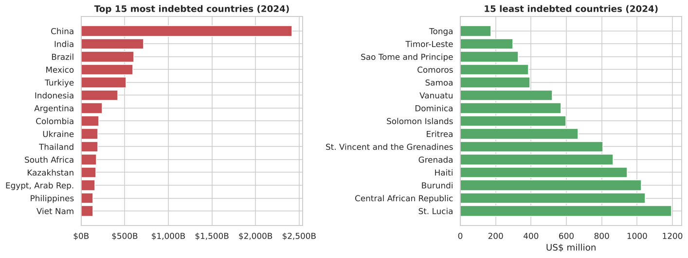

### 3.3 Debt is extremely concentrated
- **China alone holds 27.1%** of the total. The top 5 hold 54.2% and the **top 10 hold 68.2%**.
- **18 of 120 countries hold 80%** of all debt.
- Mean $74.5B vs median $12.8B (skewness 7.7). The "average country" figure is misleading.
- Categories: **18 High** (≥ $100B, $7.21T), **51 Medium** ($10–100B, $1.57T), **51 Low** (< $10B, $0.16T).

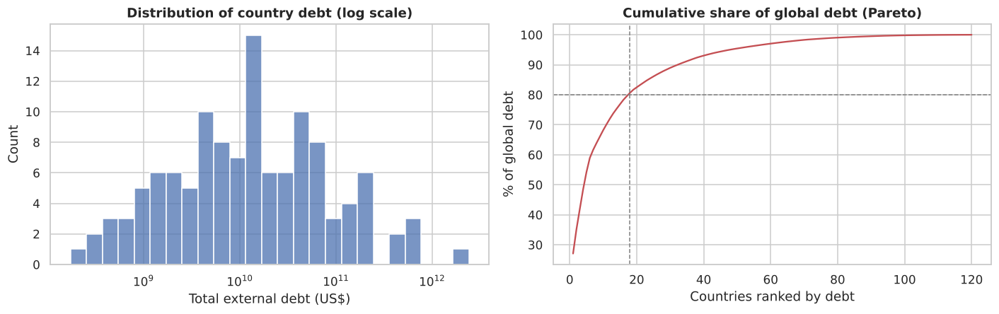

### 3.4 Regions and income groups
| Region | Countries | Total debt | Share |
|---|---|---|---|
| East Asia & Pacific | 16 | $3.41T | 38.1% |
| Latin America & Caribbean | 22 | $2.00T | 22.4% |
| Europe & Central Asia | 18 | $1.17T | 13.1% |
| Sub-Saharan Africa | 45 | $0.90T | 10.1% |
| South Asia | 6 | $0.90T | 10.0% |
| Middle East & North Africa | 13 | $0.56T | 6.3% |

Sub-Saharan Africa has the most countries (45) but the smallest typical debt (median $6.7B). South Asia has only 6 countries but the highest median ($33.5B).

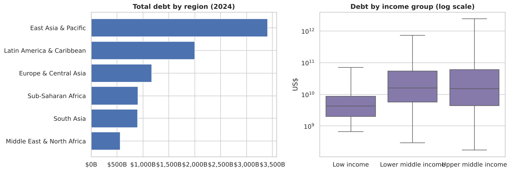

### 3.5 Composition: who owes the money
| Component | Share of total (2024) | Largest component in… |
|---|---|---|
| Public & publicly guaranteed (long-term) | 39.8% | 101 countries |
| Private non-guaranteed (long-term) | 29.2% | 11 countries |
| Short-term | 26.8% | 4 countries |
| IMF credit & SDR | 4.2% | 4 countries |

For most countries the debt is **government debt**. China is the exception: 54% of its debt is **short-term**, which is why short-term debt makes up such a large share of the global total.

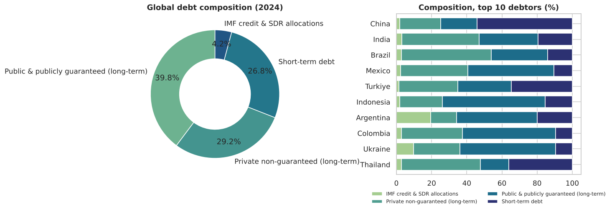

### 3.6 Debt service is rising faster than debt
| US$ billion | 2010 | 2020 | 2024 |
|---|---|---|---|
| Disbursements (long-term) | 576 | 1,142 | 994 |
| Principal repayments (long-term) | 314 | 795 | 850 |
| Interest payments (total) | 124 | 265 | **416** |
| Total debt service | 441 | 1,065 | **1,293** |

**Interest payments grew 57% from 2020 to 2024, while the debt stock grew only 10%.** Each dollar of debt now costs much more to carry. Meanwhile disbursements (new long-term lending) fell from their 2020 level.

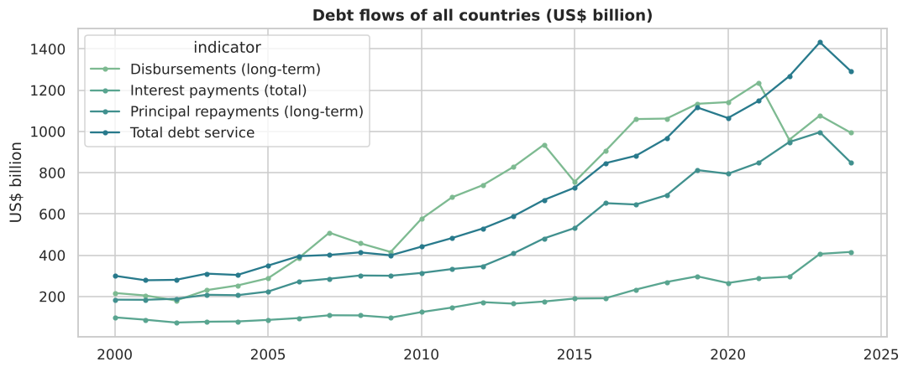

### 3.7 Size is not the same as burden
Relative to the economy, the ranking changes completely. The correlation between debt size and debt/GNI is only 0.11.

| Debt as % of GNI (2024) | | Debt service as % of exports (2024) | |
|---|---|---|---|
| Mozambique | 350.6% | El Salvador | 96.2% |
| Mongolia | 181.9% | Haiti | 63.2% |
| Senegal | 150.7% | Egypt | 49.2% |
| Mauritius | 123.2% | Kazakhstan | 48.4% |
| Lao PDR | 115.4% | Mozambique | 46.5% |

The median country owes 43.9% of its GNI. **9 countries owe more than 100% of GNI.**

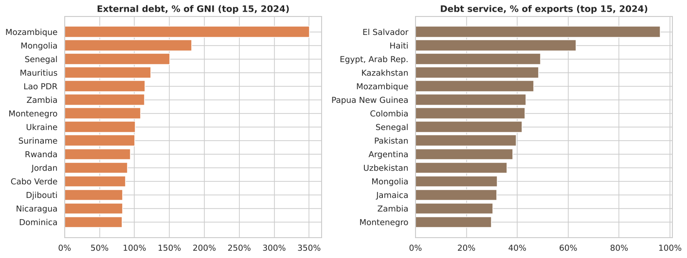
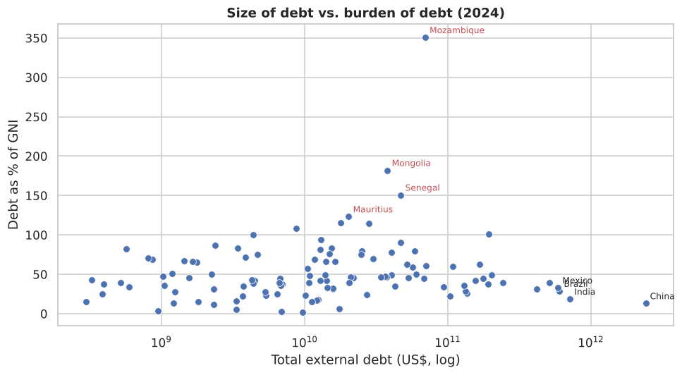

### 3.8 Fastest growth (2014–2024, countries with > $5B in 2014)
Uzbekistan (+19.1% a year), Senegal (+15.9%), Cote d'Ivoire (+15.3%), Egypt (+14.1%), Bangladesh (+11.4%).

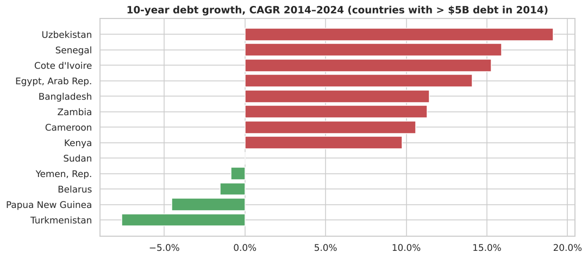

### 3.9 Relationships between indicators
Debt, debt service, interest and GNI are strongly correlated with each other, because bigger economies borrow more. *Debt % of GNI* and *reserves % of debt* behave differently, which is why both are needed to judge risk.

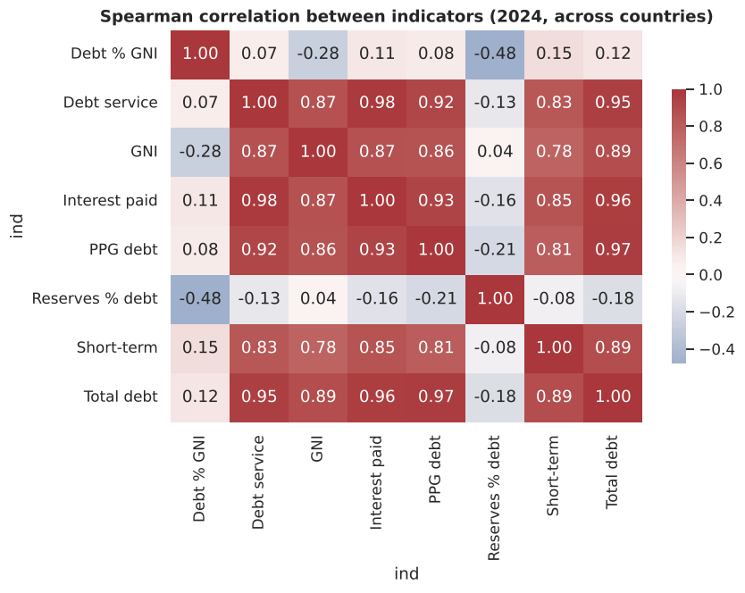

### 3.10 Scheduled repayments
Long-term debt service already scheduled for 2025 is **$1,148B**, above the $1,114B paid in 2024. The schedule only covers existing debt, so the decline after 2027 does not mean repayments will fall. New borrowing will add to it.

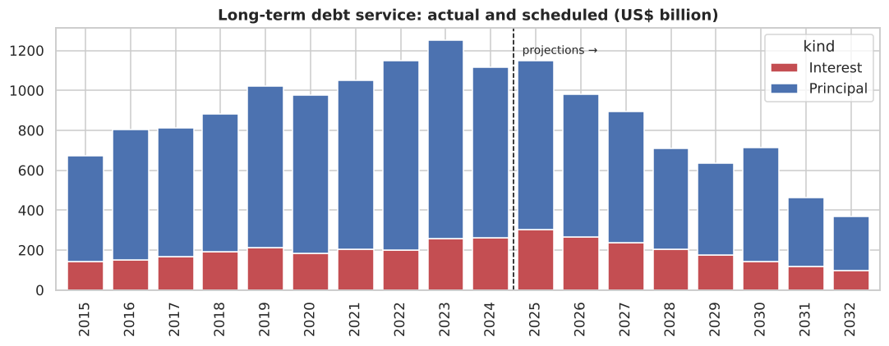

## 4. Conclusions
1. **Concentrated:** a handful of large economies dominate the dollar totals, so global averages hide the real picture.
2. **Burden ≠ size:** the most vulnerable countries are small economies with high debt/GNI or debt-service/exports ratios (Mozambique, Mongolia, Senegal, El Salvador, Haiti), not the largest debtors.
3. **Cost pressure:** interest costs are rising much faster than debt itself, while new lending has slowed. Countries are paying more to service their debt and receiving less new financing.
4. **Mostly government debt:** most of this debt is public or publicly guaranteed, so the risk sits with governments.
